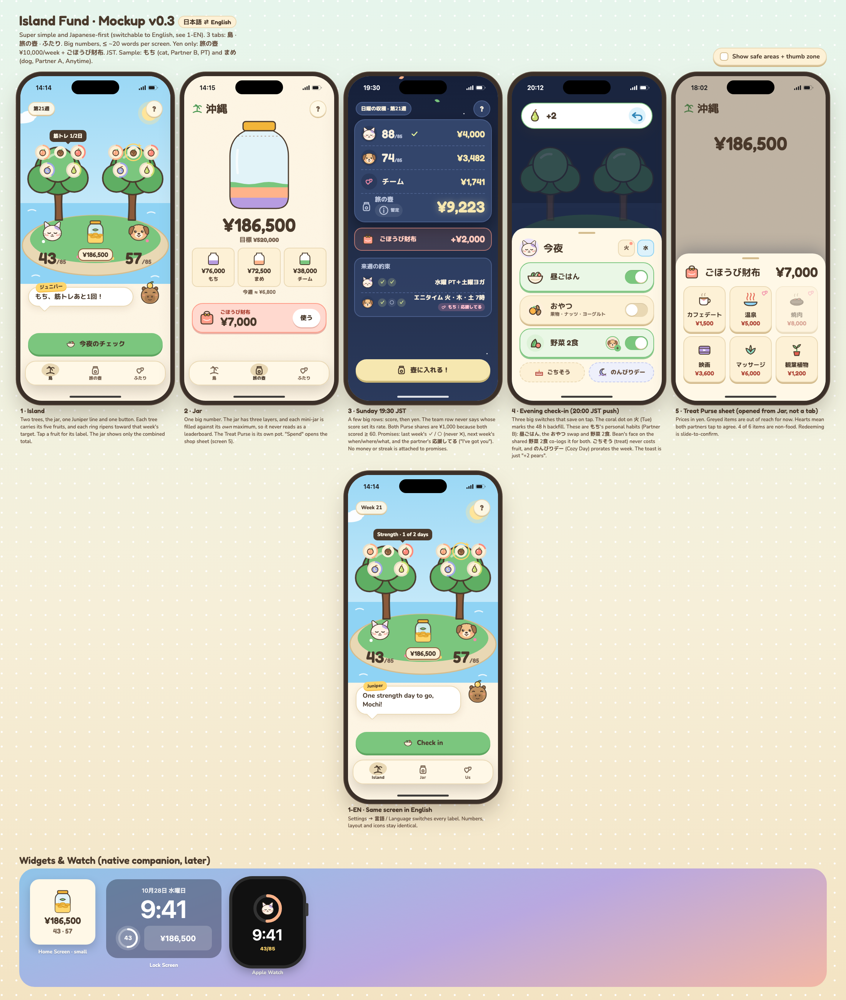

# しまの貯金箱 · Island Fund 🏝️

A private, cozy, Animal Crossing–inspired fitness and healthy-eating app for two people in Japan.
Healthy habits, tracked automatically by Apple Watch, grow fruit. Every Sunday that fruit puts real yen into a shared trip jar (¥520,000/year) and a treat purse.
Japanese-first UI (switchable to English), 3 simple pages, self-hosted.

**Start here → [`docs/PROPOSAL.md`](docs/PROPOSAL.md)** · Mockup: open [`docs/design/mockup.html`](docs/design/mockup.html) in a browser.

## Repo layout
| Path | Contents |
|---|---|
| `docs/PROPOSAL.md` | The cohesive proposal (v2.0) |
| `docs/profiles.md` | Participant profiles, gyms, eating patterns |
| `docs/decisions/` | Decision records 0001–0007 (ingestion, scoring, economy, check-in/privacy, hosting, yen, Japanese UI) |
| `docs/team/` | Role memos: round 1, round 3 (Japan), personalized nutrition |
| `docs/reviews/` | Cross-review round 1 and sign-off round 2 |
| `docs/research/` | Apple Health ingestion research |
| `docs/design/` | Mockup, style guide, preview |

## Status
Design complete (v2.0). Next: answer the open questions in PROPOSAL §8, then Phase 0 spike (Tailscale + Health Auto Export + gym Shortcuts).
