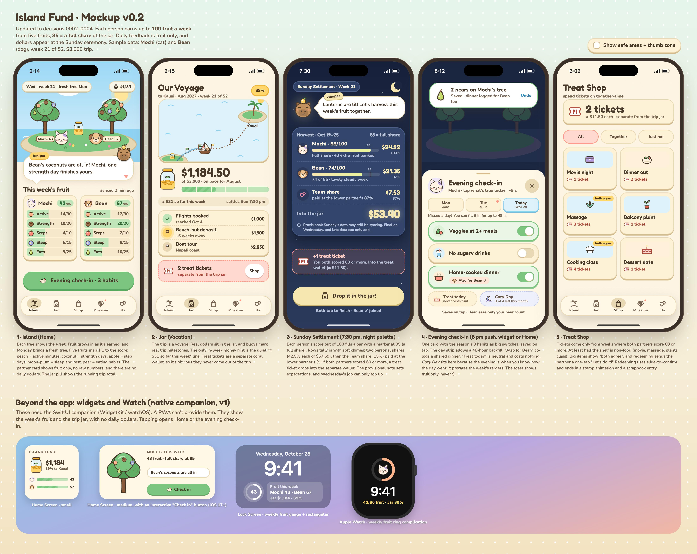

# Island Fund 🏝️: Proposal v1.0

*A cozy two-player island where everyday healthy habits, measured automatically by Apple Watch, grow fruit, and every Sunday that fruit becomes real money for the vacation you earned together.*

Prepared by the team (lead, software engineer, UI/UX designer, nutritionist, fitness coach, motivational coach).
Detailed memos are in [`team/`](team/), cross-reviews in [`reviews/`](reviews/), decisions in [`decisions/`](decisions/), and the visual mockup in [`design/mockup.html`](design/mockup.html).



---

## 1. The idea in one minute

| | |
|---|---|
| **Who** | Partner A (M, 29, 175 cm, 66 kg) and Partner B (F, 26, 153 cm, 55 kg). Both are at a healthy weight, so the goal is **fitness, strength, sleep and eating habits**, not weight loss. |
| **What** | A private, self-hosted, installable iPhone web app (PWA), later with a small native companion for widgets and the Watch. |
| **Effort** | **0 seconds** for activity and sleep (automatic from Apple Watch). **≤ 10 seconds/day** for one evening eating check-in. No importing or exporting, ever (apart from a one-time history backfill at setup). |
| **Money** | Pre-commit a vacation budget (default **$3,000**) plus a treat budget (default **$50/month**). Healthy weeks unlock it into the **Jar**. Realistic effort (~85% of plan) unlocks **the full vacation**. Unearned money is never lost; it simply stays as savings. |
| **Timeline** | 52 weeks in four 13-week seasons. Targets grow gradually from each person's own measured baseline. |
| **Look & feel** | Original Animal Crossing–inspired cozy island: cream paper cards, leaf greens, rounded type, two animal villagers, and a gentle capybara guide called Juniper. No Nintendo names or assets. |

**The one-sentence rule the couple needs to remember:**
> **Healthy habits grow fruit; every Sunday your fruit fills the vacation jar and earns treat tickets.**

---

## 2. Goals: what "healthy and realistic" means for you two

Grounded in the CDC / US Physical Activity Guidelines (150–300 min moderate activity per week, plus muscle-strengthening on 2+ days) and the Dietary Guidelines for Americans (2025–2030).
See [fitness-coach.md](team/fitness-coach.md) and [nutritionist.md](team/nutritionist.md).

### 2.1 Principles everyone agreed on
1. **Reward behaviors, never body outcomes.** Weight, calories burned, the Move ring, HRV and VO2 max are never paid. They're shown as private trends at most.
2. **Everything is relative to your own baseline**, so both partners earn identical dollars for hitting their own targets, regardless of body size or starting fitness. (Partner B burns ~15–20% fewer calories for the same workout purely from body size, which is why calories are excluded.)
3. **Weekly, not daily.** Weekly goals with slack (e.g. "5 of 7 days") prevent the "what-the-hell" collapse after one bad day.
4. **More is not better.** Category caps and daily caps mean overtraining earns nothing.
5. **Rest is part of the plan.** Easy weeks, rest days and Cozy Days are built in and still pay.

### 2.2 Starting point
- At setup the server backfills **~12 weeks of Health history**. The baseline is the median week, which a sick week or one big hike can't distort.
- Then a **2-week calibration** pays a flat participation rate while the Watch observes normal life.
- A short PAR-Q+-style safety questionnaire runs once at onboarding.

### 2.3 The 12-month arc (placeholders until calibration)

| | Season 1 · Planting (Nov–Jan) | Season 2 · Growing (Feb–Apr) | Season 3 · Harvest (May–Jul) | Season 4 · Celebration (Aug–Oct) |
|---|---|---|---|---|
| **Partner A** active min/wk | 135 → 150 | 160 | 175 | 185 |
| **Partner B** active min/wk | 85 → 105 | 115 → 135 | **150** ✓ guideline | 160 |
| **Strength days** | A: 2 · B: 1 → 2 | 2 (build) | 3 (opt-in) | 2–3 (consolidate) |
| **Steps (5 of 7 days)** | A 7,500 · B 6,250 | A 8,000 · B 6,750 | A 8,500 · B 7,250 | A 9,000 · B 7,750 |
| **Sleep** | 7 h asleep, 5 of 7 nights | → | → | → |
| **Eating habits** | Veggies at 2+ meals · No sugary drinks · Home-cooked dinner | + Palm of protein each meal | + Calcium-rich foods (bone health) *or* kitchen closes 2–3 h before bed | Maintain; lighter targets through the holidays |
| **Couple milestone** | Meal-prep Sunday | Cook-together night | Couples cooking class (treat) | **5K or long hike together**, then the vacation |

- Every season has 3 build blocks with an **easy week (×0.8)** after each, then a **recovery and re-tune week (×0.6)**. Both still pay in full when met.
- **Adaptive progression:** each 4-week block either *advances* (3–4 weeks met), *holds* (2 met) or *steps back 10%* (0–1 met). The step-back message is "re-tuned to fit your life", never a penalty. Targets stop rising at 300 min/wk, 10,000 steps and 7–7.5 h of sleep.
- **Partner B's bone-density focus:** progressive strength plus short jump sets (10 → 60 landings). Bone density built in your 20s pays off for decades.
- Nutrition background numbers are used for advice and tips only, **never shown or scored**. Protein: A ~80–105 g/day, B ~65–90 g/day. Fiber: A ~30–38 g, B ~25 g. B also needs 18 mg iron and 1,000 mg calcium a day.
- **Weight is not tracked** by default. If it's ever enabled, it's opt-in, private, trend-only, and only used to flag *under*-fuelling, which is the bigger risk for active people at a healthy weight.

---

## 3. Gamification: how fruit becomes money

Full rationale is in [motivational-coach.md](team/motivational-coach.md). Binding rules are in [ADR 0002](decisions/0002-one-scoring-model.md) and [ADR 0003](decisions/0003-economy.md).

### 3.1 Three concepts, nothing more

| Concept | What it is | Real money? |
|---|---|---|
| 🍎 **Fruit** | Weekly points, up to 100 per person | No |
| 🫙 **Jar** | The vacation fund, filled every Sunday | **Yes** (budget ÷ 52 per week) |
| 🎟️ **Tickets** | Treat currency (dining out, dates, little luxuries) | **Yes** (separate treat budget) |

### 3.2 The weekly fruit card (per person, max 100)

| Fruit | Category | Weight | How it's measured |
|---|---|---|---|
| 🍑 Peach | Active minutes vs. personal weekly target | **30** | Watch exercise minutes (auto) |
| 🥥 Coconut | Strength days (strength, HIIT, yoga/pilates ≥ 20 min) | **20** | Watch workout type (auto; one tap to start the workout on the Watch) |
| 🍎 Apple | Step goal hit on 5 of 7 days | **10** | Watch (auto) |
| 🫐 Moon-plum | Sleep target hit on 5 of 7 nights (12) + at least 1 rest day (3) | **15** | Watch sleep (auto) |
| 🍐 Pear | Eating habits, 15 of 21 ticks (3 habits × 7 days) | **25** | One evening check-in (≈ 3 taps) |

Each category pays linearly by percentage of target, capped at its weight. **85 fruit = a full week.**
Fruit above 85 is *extra fruit*: it can make up an earlier shortfall, but never adds beyond the plan.

### 3.3 The money, worked through (defaults; all configurable)
- **Jar per week** = $3,000 / 52 = **$57.69**, split three ways:
  - Partner A share 42.5% (**$24.52**) → paid at `min(A's fruit / 85, 1)`
  - Partner B share 42.5% (**$24.52**) → paid at `min(B's fruit / 85, 1)`
  - **Team share** 15% (**$8.65**) → paid at the **lower** partner's ratio. Helping each other is literally worth money.
- **Treat ticket:** each week that *both* partners score ≥ 60 earns 1 ticket (≈ **$11.54**), which works out to roughly the $50/month treat budget. It's deliberately easy, close to a "showed up" allowance, so food rewards stay guilt-free and decoupled from performance.
- **Year-end outcomes** (both partners at a similar level):

| Typical week | Jar after 52 weeks |
|---|---|
| ≥ 85 fruit (≈ "most of the plan, most weeks") | **$3,000**, the full trip |
| 75 fruit | ~$2,650 + any extra-fruit recovery |
| 60 fruit | ~$2,100 |
| 40 fruit | ~$1,400 |

Nobody "fails the vacation". Effort scales the trip smoothly, and money that isn't unlocked stays in your savings account.

### 3.4 The Treat Shop (tickets)
Planned, guilt-free treats, never "cheat meals". **At least half the items are non-food.**

| Item | Tickets |
|---|---|
| Fancy coffee / dessert date | 1 |
| Movie or museum night | 2 |
| Dinner out at a favorite spot | 4 |
| Couples cooking class / massage | 6–8 |
| New plant, workout gear, a book | 2–4 |

Any item costing 4+ tickets needs both partners to tap "yes" (shared money, shared decision).

### 3.5 Game loops

| Loop | Rhythm | What happens |
|---|---|---|
| **Daily** (~30 s) | Open the app, or just glance at a widget | Your tree grows fruit as Watch data arrives; Juniper suggests *one* doable next step ("Bean is 2,900 steps from an apple. Evening stroll together?"); evening check-in. |
| **Weekly** | **Sunday 7:30 pm Settlement** (night palette) | Rows tally with soft chimes, coins drop into the jar, both partners tap "Drop it in the jar!", and an island upgrade is revealed after good weeks. The amount is provisional; late data can only *add* (a Wednesday top-up). |
| **Monthly** | Transfer Day | Reminder to move the month's unlocked money into the vacation account; tap Done. A landmark: "1/12 of the way there 🏝️". |
| **Seasonal** (13 wk) | Season opener + finale | Targets re-tuned, fresh-start bonus week, 2–3 cooperative events (e.g. *Fishing Tourney*: each workout is a cast that catches a random critter), 10–15 seasonal collectibles that return next year, and a recap card with a "keep / drop / swap" habit retro. |
| **Yearly** | **Big Unlock Day** | Confetti, the final total, a museum tour of the year, a printable "Island Passport". The vacation itself runs in auto-pause mode. |

### 3.6 Collections and streaks (cosmetic only, never money)
- **Museum:** fossils = milestones (100 workouts, 30 sleep nights), critters = random catches from workouts, art = personal bests, recipes = home-cooked dinners you name.
- **Streaks are weekly** ("weeks at ≥ 70%"), with ❄️ freeze tokens (1 per 4 good weeks, up to 3 banked). A broken streak celebrates the *best* streak and invites a new one.
- Variable rewards (a balloon present, a rare villager visit) exist **only in cosmetics**. Money is always predictable and fair.

### 3.7 Life happens: Cozy Days
A single mechanism replaces all the sick / travel / low-energy rules. Mark a day as a **Cozy Day** and that week's targets prorate, so a full share is still reachable.
Up to 4 per month need no explanation. A fully paused week (illness, or the vacation itself) pays at your trailing 4-week rate, up to 2 weeks per season. If the Watch sees a resting-HR spike or HRV dip *and* poor sleep, Juniper gently suggests a Cozy Day. That's a suggestion only.

### 3.8 Couple dynamics
- **Cooperative, never competitive.** No leaderboards on raw numbers; each person is compared only with their own past self.
- **Team share** pays at the lower partner's ratio, so the stronger partner is rewarded for inviting the other on a walk, not for out-performing them.
- **Workouts together** (overlapping ≥ 70%) earn a shared cosmetic and a museum entry.
- **High-fives**: one tap sends your partner a little villager animation.
- **Privacy defaults:** your partner sees your fruit and % of target. Raw numbers (steps, sleep hours) are opt-in per metric. Individual eating answers are never shown, only the pear count. The server enforces this.

### 3.9 Tone
At most one notification a day, sleep-aware, and celebratory rather than nagging.
*"Strength day done! Your bones say thank you, and so does the whole island."* / *"Some weeks are cozy weeks. A brand-new week starts tomorrow 🌱"*
The words **failed, missed, lost, behind, cheat day, burn off, earn your food** and any body commentary are banned from the copy.

---

## 4. Architecture

Detail: [software-engineer.md](team/software-engineer.md), [research/apple-health-ingestion.md](research/apple-health-ingestion.md), ADRs [0001](decisions/0001-health-data-ingestion.md) and [0005](decisions/0005-client-and-hosting.md).

```
 ┌──────────── iPhone A / iPhone B ────────────┐
 │ Apple Watch ─► Apple Health                 │
 │                  │                          │
 │   MVP: Health Auto Export (REST automation) │       Tailscale (private, HTTPS *.ts.net)
 │   v1 : Island companion app (HealthKit bg)  ├───────────────────────┐
 │                                             │                       ▼
 │   PWA (home screen) ◄── web push ───────────┤      ┌──────────────────────────────┐
 │   Widgets (Scriptable → native in v1)       │      │ Home server (Mac mini / Pi 5) │
 └─────────────────────────────────────────────┘      │  SvelteKit + SQLite (WAL)     │
                                                      │  /ingest  → raw payloads      │
                                                      │  daily_metrics, workouts      │
                                                      │  rules engine → ledger        │
                                                      │  Litestream → encrypted backup│
                                                      └──────────────────────────────┘
```

### 4.1 Key choices

| Area | Choice | Why |
|---|---|---|
| Health data, MVP | **Health Auto Export** Premium (~$24.99 lifetime; Family Sharing covers both phones) → REST to our server | About 10 min of setup per phone, then hands-off. The only path that's reliable *today* without writing Swift. |
| Health data, v1 | **Native SwiftUI companion** (HealthKit observer + anchored queries + background delivery), $99/yr Developer Program + TestFlight; CI re-uploads before the 90-day expiry | Removes the third-party dependency and adds home/lock-screen widgets with an interactive check-in button, plus a Watch complication |
| Server | SvelteKit (node) + SQLite + Drizzle, Docker | One language end to end; SQLite is perfect for 2 users |
| Hosting | Always-on home Mac mini or Raspberry Pi 5 (a $5 VPS is the fallback) | Health data never leaves your hardware |
| Network | **Tailscale only**, VPN On Demand on both phones | Nothing on the public internet; free Personal plan |
| Client | **PWA** installed to the home screen; mobile-first (safe areas, Dynamic Island, bottom tabs, 44 pt targets) | Instant updates, no App Store, web push on iOS 16.4+ |
| Money | **Virtual ledger + monthly Transfer Day**; no bank APIs | Simple, safe, and humans stay in control |
| Backups | Litestream to encrypted object storage + monthly restore drill; raw payloads retained | Everything can be recomputed from source |

### 4.2 Why not other client options?
- **Native-only from day one:** best polish, but weeks slower to first value. It arrives as the v1 *companion* instead.
- **Capacitor/Expo wrapper:** still needs Swift for widgets and background HealthKit, so it's complexity without a payoff.
- **Shortcuts-only ingestion:** fails while the phone is locked. Kept only for optional one-tap check-ins and the Action Button.
- **Free Apple signing:** builds expire every 7 days. Not viable for "no manual work".

### 4.3 Data and rules engine
- **Tables:** `person`, `raw_payload`, `daily_metric(person, day, metric, value)`, `workout`, `checkin`, `season`, `target(person, season_block, category, value)`, `weekly_score`, `ledger_entry(idem_key UNIQUE, kind, amount, …)`, `ticket`, `redemption`, `cozy_day`, `collectible`.
- **Idempotent by construction:** ingest upserts by (person, day, metric). The rules engine is a pure function of daily aggregates and targets. Days are provisional until **D+2**. The ledger is append-only with unique idempotency keys. Late data produces **top-ups only**, never clawbacks.
- **Rules as data (v1):** a versioned rules table plus an admin page with a dry-run diff before recompute.

### 4.4 Privacy and security
Self-hosted. Tailscale-only access. Per-person auth (passkey or Tailscale identity). Partner-visibility rules are enforced in the API. No third-party analytics, and no cloud AI on health data (any future photo tagging runs as a local model on the home server). There's an export-everything button for your own data.

---

## 5. Presentation: what you'll see

Detail: [ui-ux-designer.md](team/ui-ux-designer.md), [design/style-guide.md](design/style-guide.md), [design/mockup.html](design/mockup.html) (open it in a browser).

**Visual language:** a sun-warmed island scrapbook. Cream paper cards, leaf green, sky blue, sand and soft coral. Chunky rounded buttons and speech-bubble dialogs.
Fonts are Fredoka, Nunito and Zen Maru Gothic (all SIL OFL). A night palette runs 7 pm–6 am, like the game. Colour contrast meets WCAG AA, and reduce-motion and Dynamic Type are respected.

**Cast:** two villagers you each choose and name (placeholders: *Mochi* the sleepy cat and *Bean* the cheerful dog), plus **Juniper**, a capybara with a yuzu on her head, who runs the jar and hosts Sunday Settlement.

| Screen (bottom tab) | What it shows |
|---|---|
| 🏝️ **Island** (home) | Both villagers and their trees. Each tree carries this week's five fruit slots, ripening as goals progress, and Monday brings a fresh tree. Juniper's one-line suggestion. The evening check-in button sits in the thumb zone. |
| 🫙 **Fund** | "Our Voyage": a little boat sails a dotted route to your real destination, with buoys at real milestones (flights booked, hotel deposit). The jar shows dollars, plus a quiet "≈ $X so far this week" and your ticket wallet. |
| 🎟️ **Shop** | Redeem treat tickets; big items need both partners to say yes. |
| 🏛️ **Museum** | Fossils, critters, art and recipes from your year. |
| 💞 **Us** | Partner view (fruit and %), high-fives, Cozy Day toggle, privacy settings. |
| 🌙 **Settlement** (Sunday overlay) | A skippable ceremony: tally, chimes, coins into the jar, island upgrade. |

**Beyond the app (v1 native companion):** a small home-screen widget (jar + this week's fruit), a medium widget with an interactive "Check in" button, a lock-screen gauge, and an Apple Watch complication showing the fruit ring and jar %.

---

## 6. Roadmap

| Phase | Effort | Scope | Exit criteria |
|---|---|---|---|
| **0 · Spike** | 1 evening | Tailscale on server + phones; HAE automations; capture real payloads as fixtures; test the history backfill | Real data from both phones lands on the server |
| **1 · MVP** | ~3 weekends | Ingest → daily metrics → 5-fruit weekly scoring → Sunday settlement → ledger; PWA screens Island / Fund / Check-in / Shop (basic) / Transfer Day; web push; Litestream | 2 weeks of hands-off data with ≤ 1 missed day per person; nobody touched HAE |
| *Calibration* | 2 weeks | Flat participation pay while baselines are measured | Season 1 targets agreed by both |
| **2 · v1** | ~4–6 weekends (after 6–8 weeks of use) | Seasons + adaptive targets, Museum, streaks/freezes, Cozy Days, rules-as-data admin, **native SwiftUI companion** (HealthKit sync, widgets, Watch complication) | HAE retired; widgets in daily use |
| **3 · Delight** | Ongoing, seasonal | Seasonal events and collectibles, Live Activity during workouts, year-end storybook, optional local-model meal-photo diary | Still opened weekly in month 12 |

**Content cadence:** one small seasonal content drop per quarter (≈ an evening each) keeps novelty alive for 12 months.

---

## 7. Risks and mitigations

| Risk | Mitigation |
|---|---|
| Health data arrives late or irregularly | Re-send yesterday on every run; D+2 finalisation; Wednesday top-ups; v1 native sync |
| Novelty fades by month 3–4 | Seasons, fresh-start weeks, cooperative events, collectibles, weekly ceremony ritual |
| Money crowds out intrinsic motivation | Informational (not controlling) feedback; mastery and identity framing ("you're someone who lifts"); cosmetics and the museum make progress visible beyond dollars; year 2 can fade the money |
| Overtraining or injury | Category and daily caps, easy weeks, rest days that pay, recovery hints, PAR-Q+ |
| Disordered-eating dynamics | Behaviors, not calories or weight; no per-meal grading; private eating answers; treats are guilt-free; copy guardrails |
| One partner falls behind and resents it | Personal baselines, team share at the lower ratio, Cozy Days, no leaderboards |
| Home server dies | Litestream backups, monthly restore drill, re-ingestible from Health |
| HAE changes or is abandoned | Raw payload retention, schema tests, native companion in v1 |

---

## 8. Decisions we need from you

Defaults are already assumed above, so the build can start on them and adjust.

1. **Budget:** vacation amount (default $3,000), treat budget (default $50/month), and the destination with a target date (the mockup assumes Kauai, Aug–Oct 2027).
2. **Pre-commitment:** move the whole budget to a separate account up front, or set up a monthly standing transfer?
3. **Unclaimed money at year-end:** stays as savings (default), rolls into next year, or goes to a charity you pick?
4. **Current routine:** how active is each of you now (gym? running? mostly walking?), any strength-training experience, and do you have gym access or train at home?
5. **Health:** any injuries, conditions, dietary restrictions, or plans for this year (e.g. pregnancy) the coaches should know about? Any history of disordered eating? (A yes changes the nutrition design.)
6. **Habits:** current soda/alcohol intake and how often you cook, so we can pick each person's 3 starter eating habits.
7. **Sleep and workouts:** will you both wear the Watch to bed, and are you OK tapping "Start workout" on the Watch for strength sessions?
8. **Privacy:** happy with the default (partner sees fruit and %, not raw numbers or eating answers)?
9. **Hosting:** is there an always-on Mac or a Pi at home? OK to keep Tailscale on permanently on both iPhones?
10. **Costs:** OK with ~$25 one-time (Health Auto Export) now and $99/yr (Apple Developer) for the v1 native companion?
11. **Characters:** which animal, colour and name does each of you want for your villager?
